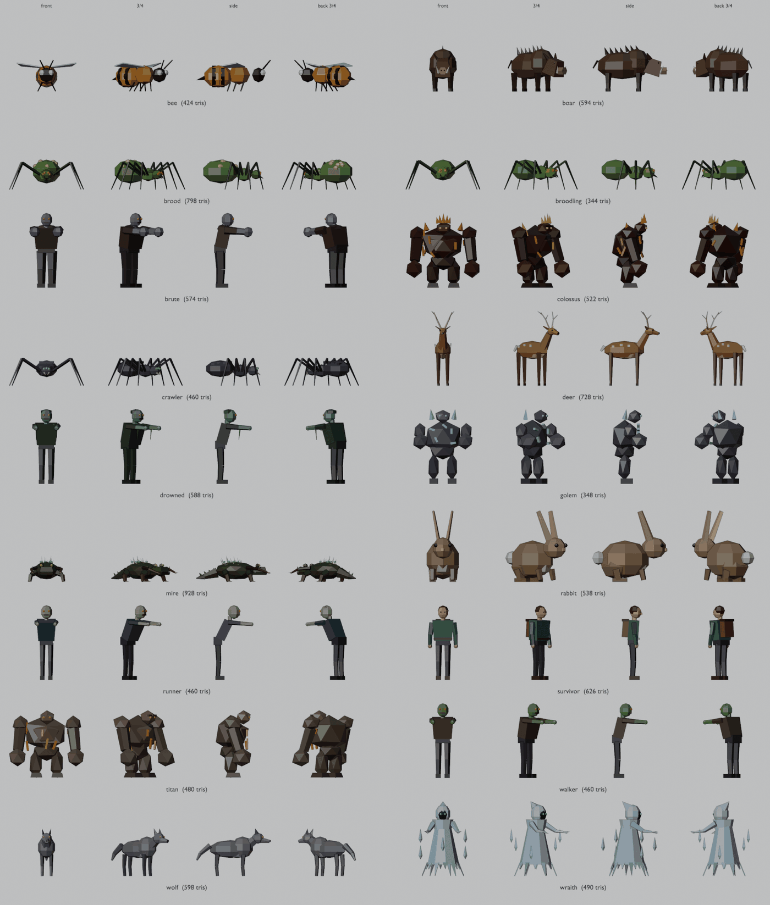

# Creature models (Blender pipeline)

Every creature in the 3D view - animals and pets, zombies, bosses and survivors - is a small
low-poly model built **by a Python script in Blender** and committed as `assets/models/<name>.glb`.
The game reads those files itself (`models3d.py`, pure Python + `struct`/`json`), so **players never
need Blender**. You only need Blender to add or change a model.



## Layout

```
tools/blender/
  lowpoly.py        helper library (runs inside Blender): Model, Part, materials, primitives,
                    quad_legs(), humanoid(), eyes()
  build_all.py      rebuilds every model -> assets/models/<name>.glb
  preview.py        renders a contact sheet (front / 3-4 / side / back 3-4) of the built .glb files
  models/
    animals.py      rabbit, deer, boar, wolf, bee   (pets reuse these)
    zombies.py      walker, runner, brute, drowned, broodling, crawler, golem
    bosses.py       titan, brood, wraith, mire, colossus
    survivor.py     survivor (players, with optional helmet / armor / cloak)
assets/models/*.glb the built models (commit these!)
models3d.py         game side: loader, instanced drawing, vertex-shader animation, attachment points
```

## Commands

Blender 4.2+ (tested with 5.3). On a Mac it is `/Applications/Blender.app/Contents/MacOS/Blender`
or `/opt/homebrew/bin/blender`; on Windows `blender.exe` from the install folder.

```
# rebuild everything (about 2 seconds)
blender --background --factory-startup --python tools/blender/build_all.py
# rebuild just some
blender --background --factory-startup --python tools/blender/build_all.py -- fox goat
# contact sheet of all models (or some), optional parts hidden unless --gear
blender --background --factory-startup --python tools/blender/preview.py -- docs/models_sheet.png
blender --background --factory-startup --python tools/blender/preview.py -- /tmp/fox.png fox wolf --gear
```

`build_all.py` prints the triangle count and number of parts for every model - keep an eye on it.
Then run the game (`python3 main.py`, press **V** for first person) to see it moving.

## Adding a creature (e.g. a tundra fox)

1. Add a function to a file in `tools/blender/models/` (an existing one, or a new `tundra.py` -
   every `*.py` there that has a `MODELS` dict is picked up automatically; files starting with `_` are skipped):

```python
from lowpoly import Model, eyes, glow, mat, quad_legs, shade

def tundra_fox():
    M = Model("tundra_fox", {
        "anim": {"stride": 0.6, "bob": 0.04, "nod": 0.06, "wag": 0.6, "lunge": 0.35},
        "stride_len": 1.1,          # metres walked per full leg cycle (sets how fast legs move)
        "height": 0.7,
    })
    fur = (232, 236, 240)                       # take colours from the sprite in art*.py
    b = M.part("body", (0, 0, 0.5), "body")     # name, pivot, role
    b.ball((0, 0, 0.5), (0.4, 0.15, 0.16), mat(fur))
    h = M.part("head", (0.35, 0, 0.62), "head")
    h.ball((0.45, 0, 0.66), (0.12, 0.1, 0.1), mat(fur))
    h.limb((0.5, 0, 0.64), (0.66, 0, 0.6), 0.06, 0.02, mat(fur))           # snout
    eyes(h, 0.54, 0.05, 0.7, 0.018, mat((30, 20, 20)), M=M)                  # + eye_l / eye_r points
    t = M.part("tail", (-0.38, 0, 0.55), "tail")
    t.limb((-0.38, 0, 0.55), (-0.75, 0, 0.42), 0.08, 0.03, mat(fur))
    quad_legs(M, 0.22, -0.25, 0.08, 0.42, 0.04, 0.025, mat(shade(fur, 0.85)))
    return M

MODELS = {"tundra_fox": tundra_fox}
```

2. Rebuild (`build_all.py -- tundra_fox`) and look at the preview.
3. Nothing else is needed if the game's `kind` equals the model name: `models3d.model_for(kind)`
   looks up `assets/models/<kind>.glb`. To share a model between kinds, add a line to
   `models3d.MODEL_FOR`, e.g. `"snow_wolf": "wolf"`. A kind with no model falls back to the old
   painted cut-out, so nothing breaks while a model is missing.
4. Commit the script **and** the `.glb`.

Animals, zombies (`L.zombies`), bosses and survivors are already hooked up in
`CreatureModels.models3d_draw()`. A brand-new *list* of creatures (fish in ponds, say) needs a loop
there that calls `self._m3_add(kind, sprite, x, y, heading, scale, color, alpha, ...)`.

## Conventions

* **Units:** 1 Blender unit = 1 metre = `models3d.UNIT` (55) game pixels. A survivor is 1.8 m
  (~100 px, the same height as the old cut-out). Feet at z = 0, centred on x = y = 0.
* **Facing:** the creature looks along **+X**, its left is **+Y**, up is **+Z**. The game turns it by the
  entity's `heading` (zombies, animals, bosses) or `face` (survivors), in radians, like `atan2(dy, dx)`.
* **Style:** chunky, flat-shaded, solid colours only (no textures), 100-600 triangles
  (bosses up to ~1500). Prefer `segs=5..8` on balls and limbs.
* **Parts and roles:** `M.part(name, pivot, role)` - the pivot is the joint (hip, shoulder, neck,
  tail root). The shader animates each part by its role:

  | role | used for | animation |
  |---|---|---|
  | `body` | torso, anything that rides on it | bob while walking, breathing, lunge |
  | `head` | head, ears, antlers, eyes | nods with the step, idle look, dips when attacking |
  | `leg_a` / `leg_b` | legs (fl+br are `leg_a`, fr+bl `leg_b`; humanoids leg_l/leg_r) | swing about the hip, opposite phases |
  | `sleg_a` / `sleg_b` | spider / insect legs sticking out sideways | sweep forward/back |
  | `arm_l` / `arm_r` | arms | depends on `anim.arms`: `swing` (survivor, giants), `reach` (zombies: held out, sway, raise on attack), none (small idle sway) |
  | `tail` | tails, abdomens, orbiting shards | wag side to side (faster when moving) |
  | `wing_l` / `wing_r` | wings | fast flap |
  | `jaw` | lower jaw | opens when attacking (`anim.jaw`) |
  | `still` | anything that must not move (e.g. a base) | none |

  Names like `leg_fl`, `arm_r`, `tail`, `head` get their role automatically if you leave it out.
* **`anim` settings** (all optional, 0 = off): `stride` (leg swing, radians), `bob` (metres),
  `nod`, `breathe` (share of size, bosses ~0.03), `wag`, `flap`, `hover` (metres off the ground,
  bees / wraith), `float` (metres of up-and-down drift), `lunge` (metres forward on attack),
  `sway` (zombie arm sway), `jaw`, `arms` (`"swing"` / `"reach"`).
* **Colours** (`mat(rgb, kind)`): use the RGB values of the sprite in `art.py`, `art_extra.py`,
  `art_swamp.py`, `art_bees.py`, so the model matches the 2D art. Material kinds:
  * `c` (default) - lit by the sun and the time-of-day lighting
  * `glow` - not shaded, bright (eyes, lava, crystals); `glow(rgb)` is a shortcut
  * `acc1`..`acc5` - recoloured per creature by the game: survivor jacket / hair / body armor /
    helmet / cloak, pet armor colour (`acc1`). The colour you give is the default.
* **Attachment points:** `M.attach(name, position, part_name)` - an empty that follows that part.
  * `eye_*`, `glow_*` - at night the game puts a soft additive glow there, coloured like the
    nearest `glow` surface (only if there is one right there - dark animal eyes don't glow).
  * `hand_r` - where a survivor's held item (weapon, tool, torch) is drawn.
  * Anything else (`mouth`, `head_top`, `armor`...) is free to use: `models3d.anim_point(model,
    name, inst, t)` returns its world position on the animated model.
* **Optional parts:** `M.part("pet_armor", pivot, "body", opt="pet_armor")` is only drawn when the
  instance's flags say so. Known options: `armor`, `helmet`, `cloak` (survivors, from their worn
  gear) and `pet_armor` (pets wearing armor). Add new ones to `models3d.OPTS`.

## How the game draws them

* `models3d.models()` loads every `.glb` once (about 0.15 s for all of them).
* Each frame `CreatureModels.models3d_draw()` collects one instance per visible creature and draws
  every creature of a model in **one instanced draw call** (position, heading, scale, tint, walk
  phase, moving amount, attack amount, worn-part flags, recolours).
* Walking is measured from how far a creature moved since the last frame, so the legs move on the
  host, on online clients and in split screen alike. Attacks: on the host a lunge when the attack
  cooldown restarts; on clients (no cooldowns in snapshots) a gnash while touching a survivor.
* Tint = the sprite's colour/alpha (red hit flash, frost chill, poison, the wraith fading) plus a
  white flash on hit. Lighting = sun direction + the same night light map as everything else.
* Config `creature_models` in `lastlight_config.json`: `"on"` (default; first person and tilted
  camera), `"fp"` (first person only) or `"off"` (old cut-outs). `creature_models_up` stretches
  heights in the tilted camera (default 1.0).

## Files format note

`.glb` is the standard binary glTF. Blender exports each part as a node (translation = pivot), one
primitive per material, materials named `<kind>_<rrggbb>`, parts' `role` / `opt` as node extras and
the `anim` settings as the scene extra `ll_model` (JSON). You can open the files in any glTF viewer.
